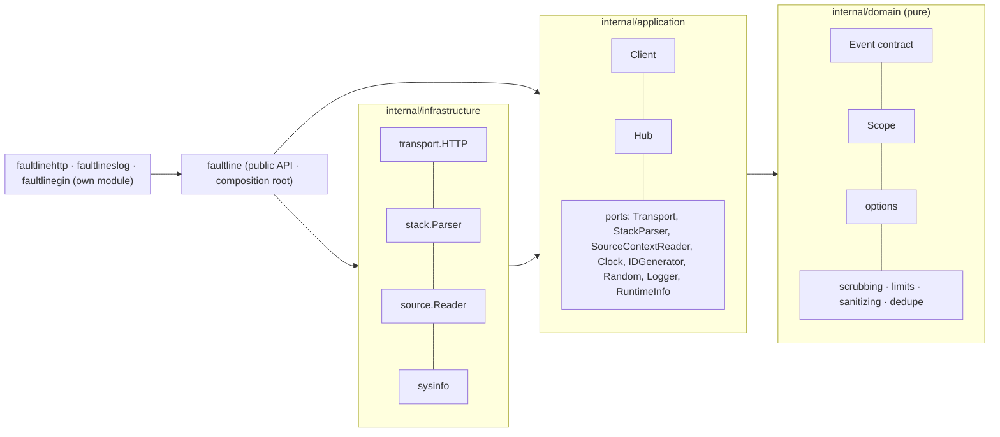
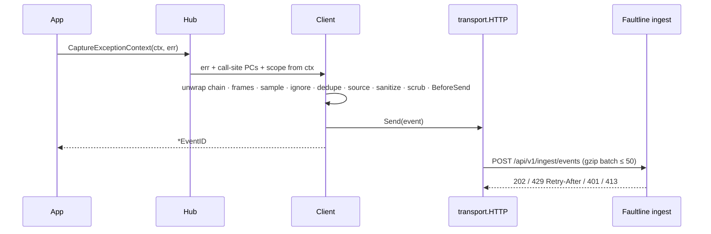

# faultline-go

The Go SDK for [Faultline](https://www.faultsline.dev), a self-hostable error-tracking
platform. It captures errors, panics and messages, adds context (stack traces with source,
breadcrumbs, request data, user, tags), scrubs secrets, and sends batched, gzip-compressed
events to the Faultline ingest API.

- **No dependencies.** The core module uses only the standard library (`net/http`,
  `compress/gzip`, `runtime`, `context`, `sync`, `log/slog`). The Gin middleware is a separate
  module.
- **Never crashes your app.** Every exported function recovers from internal panics, accepts
  nil and zero arguments, and works before `Init` and after `Close`. Internal problems are
  logged only when `Debug: true`.
- **Go ≥ 1.21.** Tested with the race detector on Go 1.21, 1.22 and 1.23.

## Install

```bash
go get github.com/getfaultline/faultline-go
go get github.com/getfaultline/faultline-go/faultlinegin   # only if you use Gin
```

> `go get` only works once the module is pushed to the public repository
> `github.com/getfaultline/faultline-go` and tagged `v0.1.0` (and `faultlinegin/v0.1.0` for
> the Gin module). Until then, use a `replace` directive pointing at a local checkout.

## Quickstart

```go
package main

import (
	"errors"
	"log"
	"os"
	"time"

	faultline "github.com/getfaultline/faultline-go"
)

func main() {
	if err := faultline.Init(faultline.Options{
		APIKey:      os.Getenv("FAULTLINE_API_KEY"), // flt_ingest_...
		Environment: "production",
		Release:     "api@1.4.2",
	}); err != nil {
		log.Printf("faultline: %v", err)
	}
	defer faultline.Close(2 * time.Second) // deliver queued events before exit
	defer faultline.Recover()              // capture a crash of main, then re-panic

	if err := doRiskyThing(); err != nil {
		faultline.CaptureException(err)
	}
	faultline.CaptureMessage("Payment webhook retried", faultline.LevelWarning)
}

func doRiskyThing() error { return faultline.WithStack(errors.New("boom")) }
```

### net/http

```go
import "github.com/getfaultline/faultline-go/faultlinehttp"

mux := http.NewServeMux()
mux.HandleFunc("/orders", func(w http.ResponseWriter, r *http.Request) {
	ctx := r.Context()
	faultline.ScopeFromContext(ctx).SetUser(faultline.User{ID: "user-123"})
	if err := loadOrders(ctx); err != nil {
		faultline.CaptureExceptionContext(ctx, err)
		http.Error(w, "failed", http.StatusInternalServerError)
	}
})
http.ListenAndServe(":8080", faultlinehttp.New(faultlinehttp.Options{}).Handle(mux))
```

The middleware:

- gives every request its own scope, carried by `r.Context()`, so `SetUser`, `SetTag` and
  breadcrumbs on one request never leak into a concurrent one;
- attaches the request (method, URL, headers, query) and an `http` breadcrumb;
- recovers panics, captures them at level `fatal` and answers `500` (or re-panics with
  `Repanic: true`). `http.ErrAbortHandler` is passed through untouched;
- reports responses with status ≥ 500 as message events (`CaptureStatus` to customize).

A runnable demo is in [`examples/nethttp`](examples/nethttp):

```bash
FAULTLINE_API_KEY=flt_ingest_... FAULTLINE_ENDPOINT=http://localhost:4000 go run ./examples/nethttp
curl localhost:3002/boom; curl localhost:3002/wrapped; curl localhost:3002/log-error
```

### Gin

```go
import "github.com/getfaultline/faultline-go/faultlinegin"

r := gin.New()
r.Use(faultlinegin.New(faultlinegin.Options{}))
r.GET("/users/:id", func(c *gin.Context) {
	faultlinegin.GetScope(c).SetTag("tenant", c.GetHeader("X-Tenant"))
	// ...
})
```

Same behavior as `faultlinehttp`, plus: the route pattern becomes the `route` tag, and when the
response status is ≥ 500 the last error added with `c.Error(err)` is captured as an exception.
With `Repanic: true` it re-panics so `gin.Recovery()` (registered before it) can respond.

### log/slog

```go
import "github.com/getfaultline/faultline-go/faultlineslog"

logger := slog.New(faultlineslog.NewHandler(
	slog.NewJSONHandler(os.Stderr, nil),               // next handler (may be nil)
	&faultlineslog.Options{EventLevel: slog.LevelError}, // optional: records >= Error become events
))
logger.InfoContext(ctx, "charging card", "amount", 42) // breadcrumb on the request scope
logger.ErrorContext(ctx, "charge failed", "err", err)   // exception event (error attribute)
```

Records at `BreadcrumbLevel` (default Info) or above become `log` breadcrumbs with their
attributes as data (groups flattened to `group.key`), on the scope carried by the record's
context or the current scope. With `EventLevel` set, records at that level or above also
become events: an exception event when the record has an `error` attribute, otherwise a
message event. Records are always forwarded to the next handler.

## API

| Function | Description |
| --- | --- |
| `Init(Options) error` | Configure the SDK. Calling it again replaces the previous client. Returns an error wrapping `ErrInvalidOptions` for invalid options; never panics. |
| `CaptureException(err) *EventID` | Capture an error with the current scope. Returns `nil` when `err` is nil, the SDK is disabled, or the event was dropped. |
| `CaptureMessage(msg, level) *EventID` | Capture a message. An empty level means `info`. |
| `CaptureExceptionContext(ctx, err)` / `CaptureMessageContext(ctx, msg, level)` | Same, using the scope carried by `ctx`. |
| `defer Recover()` / `defer RecoverWithContext(ctx)` | Capture a panic at level `fatal`, flush, then re-panic with the original value (or swallow it with `SwallowPanics`). Must be deferred directly. |
| `CapturePanic(ctx, recovered)` | Capture a value you got from `recover()` yourself. Never re-panics. |
| `SetUser(User{ID, Email, Username, IPAddress})` | Set the user on the current scope. `User{}` clears it. |
| `SetTag(k, v)` / `SetTags(map)` | Searchable string tags. |
| `SetContext(name, map)` / `SetExtra(k, v)` | Structured context (`nil` removes it) or arbitrary extra data. |
| `AddBreadcrumb(Breadcrumb{Type, Category, Message, Level, Data})` / `AddBreadcrumbContext(ctx, b)` | Manual breadcrumb. `Type` is one of `default`, `http`, `log`, `query`, `navigation`. |
| `WithScope(func(*Scope))` | Run code with a fork of the current scope. |
| `NewContext(ctx)` / `ScopeFromContext(ctx) *Scope` | Context-carried scopes for request isolation. |
| `WithStack(err) error` | Attach the caller's stack to an error, so events point at where it was created. |
| `Flush(timeout) bool` | Wait for queued events. `false` on timeout. |
| `Close(timeout) bool` | Flush and disable the SDK. |
| `IsEnabled() bool` | `true` once `Init` has succeeded. |

`*Scope` has the same setters plus `SetLevel`, `SetFingerprint`, `SetRequest`,
`SetHTTPRequest(*http.Request)`, `ClearBreadcrumbs`, `Clear`, `CaptureException` and
`CaptureMessage`. Every method is a no-op on a nil `*Scope`.

### Scopes and goroutines

Go has no goroutine-local storage, so there are two kinds of scope:

- **Context-carried scopes** (`NewContext`, `ScopeFromContext`, the `...Context` functions)
  are the right tool for concurrent code. A scope lives in a `context.Context`, is a fork of
  its parent, and is only seen by captures that use that context. The HTTP and Gin middleware
  create one per request.
- **The global scope and `WithScope`.** `SetTag` and friends write to the current scope: the
  global one, or the innermost `WithScope` fork. `WithScope` pushes its fork onto a
  process-wide stack while the callback runs, so package-level captures from *other*
  goroutines during that time also see it. Use it for sequential code; inside handlers and
  workers, prefer context scopes or `scope.CaptureException`.

### Errors and stack traces

- `exception.type` is the concrete Go type (`*fs.PathError`, `*errors.errorString`,
  `*fmt.wrapError`). A recovered non-error panic value has type `panic` and its
  `fmt.Sprint` as the value.
- The unwrap chain (`Unwrap() error` and `Unwrap() []error`, depth first) becomes the
  `cause` chain, at most 5 exceptions in total. Cycles are detected.
- Stacks are captured with `runtime.Callers` at the capture site, or at the panic site in
  `Recover`. Errors that carry their own stack keep it: `faultline.WithStack`,
  `github.com/pkg/errors` (`StackTrace()`) and `github.com/go-errors/errors` (`Callers()`). A
  wrapper that only adds a stack is folded into the error it wraps.
- Frames are ordered oldest to newest. `function` is package-qualified
  (`main.(*Server).handle`) and `module` is the import path. Frames in `GOROOT` or under
  `/pkg/mod/` are not in-app. In-app frames get ±5 lines of source context when the file is
  readable on the machine running the program.

## Options

| Option | Type | Default | Description |
| --- | --- | --- | --- |
| `APIKey` | `string` | **required** | Public ingest key (`flt_ingest_...`), sent as `X-Faultline-Key`. |
| `Endpoint` | `string` | `https://www.faultsline.dev` | Base URL of the Faultline server. Override it when self-hosting. |
| `Environment` | `string` | - | e.g. `production`, `staging`. |
| `Release` | `string` | - | e.g. `api@1.4.2` or a git sha. |
| `ServerName` | `string` | `os.Hostname()` | Reported as `serverName`. |
| `SampleRate` | `float64` | `1` | Fraction of events to send, in (0, 1]. `0` means 1; use `Enabled` to turn sending off. |
| `MaxBreadcrumbs` | `int` | `50` | Breadcrumbs kept per scope, capped at 100. Negative disables breadcrumbs. |
| `SendDefaultPII` | `bool` | `false` | When `false`, the user IP and the `cookie`, `set-cookie`, `authorization`, `proxy-authorization`, `x-forwarded-for`, `x-real-ip` and `forwarded` headers are removed. |
| `BeforeSend` | `func(*Event) *Event` | - | Modify or drop (`nil`) an event. Runs after scrubbing. If it panics, the event is dropped. |
| `IgnoreErrors` | `[]string` | - | Regular expressions matched against the exception type, the message and `"type: message"`. A plain string matches as a substring. |
| `Enabled` | `*bool` | on | `faultline.Bool(false)` turns the SDK into a no-op (`APIKey` is then not required). |
| `Debug` | `bool` | `false` | Log SDK internals (dropped events, retries, invalid options) to stderr. |
| `SwallowPanics` | `bool` | `false` | Make `Recover` swallow panics instead of re-panicking. |

Invalid options never panic:

- An invalid optional value falls back to its default; `Init` returns an error describing it
  and the SDK still runs.
- A missing `APIKey` or an unusable `Endpoint` leaves the SDK disabled (`IsEnabled()` is
  `false`).

## Self-hosting

Set `Endpoint` to your server's base URL. The SDK posts to `{Endpoint}/api/v1/ingest/events`:

```go
faultline.Init(faultline.Options{APIKey: key, Endpoint: "http://localhost:4000"})                    // local faultline-server
faultline.Init(faultline.Options{APIKey: key, Endpoint: "https://faultline.internal.example.com"})
```

## What gets sent

Each event follows the shared Faultline event contract: `eventId` (uuid v4), `timestamp`,
`level`, `platform: "go"`, `exception` (type, value, frames ordered oldest to newest, `cause`
chain), `message`, `tags`, `user`, `request`, `contexts` (`runtime: {name: "go", version}`,
`os: {name}`, plus your own), `breadcrumbs`, `extra`, `fingerprint`, `environment`, `release`,
`serverName`, and `sdk: { name: "faultline-go", version }`.

The SDK enforces the pinned limits before sending:

| Field | Limit |
| --- | --- |
| Frames | 100 (newest kept) |
| Breadcrumbs | 100 |
| Tags | 50 (key ≤ 32 chars, value ≤ 200 chars) |
| `message` / `exception.value` | 8192 chars |
| Source context | ±5 lines, each ≤ 300 chars |
| `exception.cause` chain | 5 exceptions in total |
| Batch | ≤ 50 events and ≤ 1 MB |

Values in `extra`, contexts and breadcrumb data are normalized to JSON: errors become their
message, and values that cannot be marshaled (channels, functions, NaN, cycles) become
`"[unserializable T]"`.

**Scrubbing (client side, same rules as the server and the Node SDK):**

- Values under keys matching
  `/(authorization|cookie|set-cookie|password|passwd|secret|token|api[_-]?key|x-faultline-key)/i`
  become `"[Filtered]"`. This applies to request headers and query, `extra`, contexts, tags
  and breadcrumb data.
- Credit-card-like strings (`/\b(?:\d[ -]*?){13,16}\b/`) in request, `extra` and breadcrumb
  data are also filtered, as are sensitive URL query parameters.

**Delivery:**

- `Capture*` never blocks on the network. Events wait in an in-memory queue of at most 100
  events; the oldest is dropped when it is full.
- A background goroutine sends every 2s, or as soon as 20 events are queued, in
  gzip-compressed batches. Each request times out after 5s.
- Network errors, timeouts, `5xx` and `408` are retried up to 3 times with exponential backoff
  and jitter. A `429` pauses sending until its `Retry-After`.
- A `401` or `413` response drops the batch. With `Debug: true` the SDK logs the reason.
- Identical consecutive errors within 1s are sent once.
- Call `faultline.Close(timeout)` (or `Flush`) before a deliberate exit, for example at the
  end of `main`, in CLI tools and in serverless handlers.

## Architecture

The SDK follows Clean Architecture. Dependencies point inward only, and
`architecture_test.go` enforces this in CI by inspecting every package's imports.





See [ARCHITECTURE.md](ARCHITECTURE.md) for the decision log.

## Development

| Command | What it does |
| --- | --- |
| `go test -race ./...` | Unit, integration, contract-conformance (JSON Schema) and architecture tests for the core module. |
| `cd faultlinegin && go test -race ./...` | Tests for the Gin module. |
| `go vet ./...` | Vet. |
| `gofmt -l .` | Formatting check (must print nothing). |
| `staticcheck ./...` | Static analysis (`go install honnef.co/go/tools/cmd/staticcheck@2025.1.1`). |

The SDK has no environment variables of its own; everything is passed to `Init`. The example
reads `FAULTLINE_API_KEY`, `FAULTLINE_ENDPOINT` (default `http://localhost:4000`),
`FAULTLINE_DEBUG` and `PORT` (default `3002`).

### Releasing

1. Push to the public repository `github.com/getfaultline/faultline-go`.
2. Tag the core module: `git tag v0.1.0`.
3. Tag the Gin module: `git tag faultlinegin/v0.1.0` (its `go.mod` requires core `v0.1.0`; the
   `replace ../` directive only applies when developing in this repository).
4. `git push --tags`. The Go module proxy picks the tags up on the first `go get`.

## License

MIT
